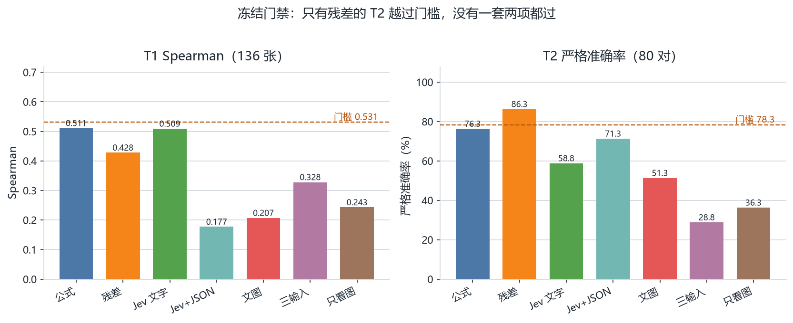
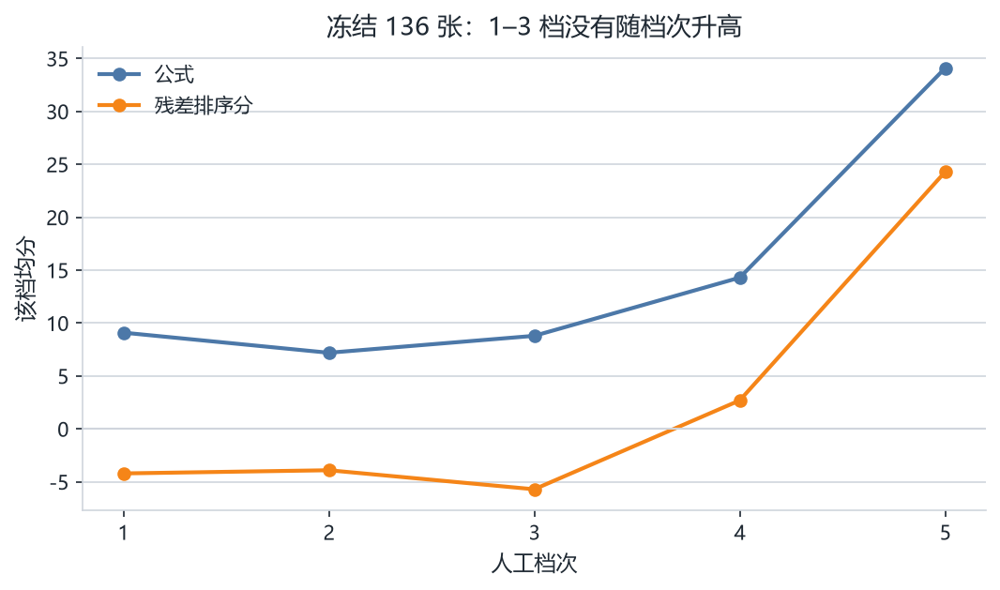
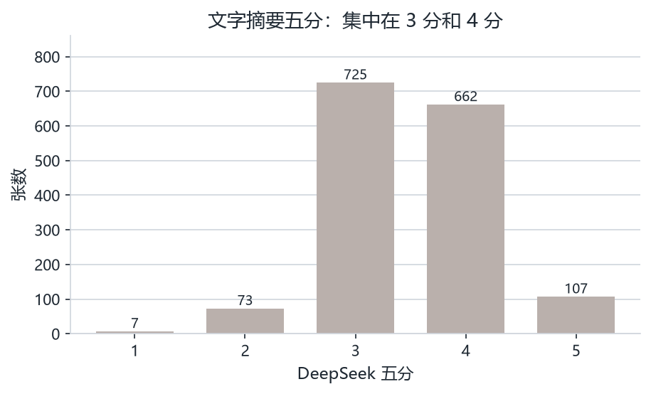
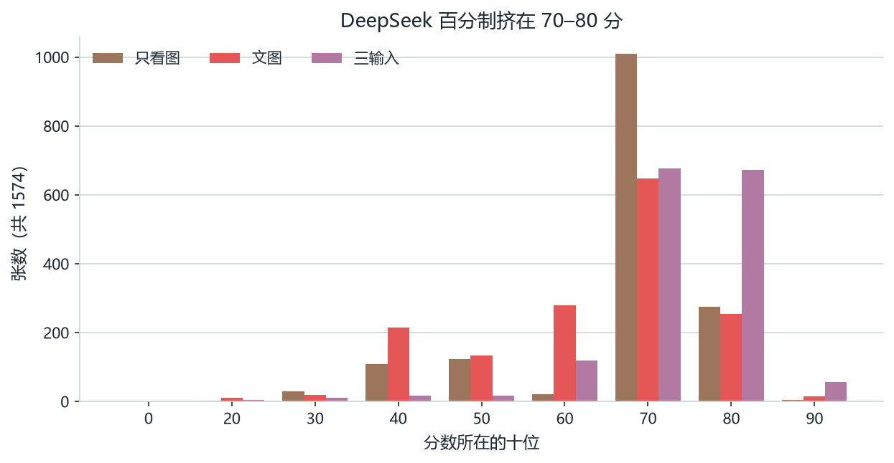

# 布局打分实验记录

日期：2026-09-22。语料、分数和统计都在 `runs/external_scores/`。对照页是 `runs/external_scores/review.html`。

本文只记录已经跑完的打分和对照。β 仍是 0。这些外部分数没有拿去训练，也没有打开强化学习的学习项。

## 结论

同一批 1574 张布局上，六类已跑搭配里，没有一套同时超过公式在冻结 gold 上的两项指标。要打开 β，学习项必须在冻结 136 张 T1 上把 Spearman 做到至少 0.531，并且在冻结 80 对 T2 上把严格准确率做到至少 78.3%。公式本身是 T1 0.511、T2 76.3%。

- 残差模型在 T2 上是 86.3%，过了成对门禁，T1 是 0.428，没过。它和公式分的 Spearman 是 0.95，残差项平均把公式分往下拉 11.3。
- Jev 只看文字摘要时，T1 是 0.509，离门禁最近，T2 只有 58.8%。
- Jev 加上 JSON 之后，T2 升到 71.3%，T1 掉到 0.177。
- DeepSeek 看图之后，分数堆在少数整数上。三输入和人工 197 条的 Spearman 最高（0.44），但冻结 80 对里有 49 对同分，严格准确率只有 28.8%。

远程接口不适合放进每一步奖励。奖励要的是本地 checkpoint 的哈希，每步给两个状态打分。学习项只有一个位置，公式始终保留。把 DeepSeek 或 Jev 和残差模型叠在一起，仍要过同一扇门；按现有数字，外部分数的 T1 和 T2 都不会补上残差模型缺的那一截，还会把残差模型在 T2 上已经高于公式的部分冲掉。

## 语料

1574 张唯一布局。来源可以重叠，所以下面的计数加起来大于 1574。

| 来源 | 张数 |
|---|---:|
| T1 gold | 136 |
| 其余已审核 T1 | 61 |
| human_pairs 训练侧 | 1110 |
| human_pairs 测试侧 | 332 |
| 有人工 1–5 分 | 197 |
| 冻结、不可训练 | 468 |

排除：T1 废弃 173 张、未标注 1 张、合成 `train_with_synth`、`cmu_perturb`、`cmu_perturb_dense`。缺文件 0。清单见 `manifest.json`。

成对标签：训练 578 对，测试 170 对，偏好都是 b 侧。冻结 T2 是测试对里的 80 对，不是全部 170 对。

随机 100 条只用于早期 Jev 抽样，种子 17，名单在 `jev_sample_ids.json`。后来的 Jev 全量不再只用这 100 条。

## 各套输入实际送了什么

文字摘要是固定的 9 行，写在 `corpus.jsonl` 的 `state_text` 里。内容是视图类型、标注条数、文字框重叠、碰轮廓、碰尺寸线、文字是否在轮廓内或视图框外、到被测边的中位距离、四边分布。1574 张里有 1336 张文字框重叠是 0。

| 搭配 | 输入 | 全量 | 刻度 | 结果文件 |
|---|---|---:|---|---|
| DeepSeek 文字摘要 | 9 行摘要 + 5 档说明 | 1574 | 1–5 | `deepseek.jsonl` |
| DeepSeek 只看截图 | 截图 JPEG，最长边 1280 | 1574 | 0–100 | `deepseek_vision.jsonl` |
| DeepSeek 文字 + 截图 | 摘要和截图一起看 | 1574 | 0–100 | `deepseek_text_image.jsonl` |
| DeepSeek 文字 + 截图 + JSON | 再加视图 state JSON | 1574 | 0–100 | `deepseek_text_json_image.jsonl` |
| Jev 文字摘要（早期） | 9 行摘要，5 档 | 100 | 1–5 | `jev.jsonl` |
| Jev 文字摘要 | 9 行摘要，10 档映射到 0–100 | 1574 | 0–100 | `jev_text_100pt.jsonl` |
| Jev 文字 + JSON | 摘要加视图 JSON，10 档映射到 0–100 | 1574 | 0–100 | `jev_text_json.jsonl` |
| 残差模型 | 256×256 的 5 通道图 + 16 维公式特征 | 1574 | 公式分 + 残差项 | `residual.jsonl` |

DeepSeek 模型是 ChatAnywhere 上的 `deepseek-v4.1-flash`（服务返回 `deepseek-v4-1-flash-260910`）。Jev 是 `jev-1.13.0`，接口 `https://api.typesafe.ai/v1/systemone`。托管 Jev 只收文字，不收图片。`awesome-jev` 里的多模态项目是别的模型，不是这个接口的改法。

残差权重是 `runs/reward_human_pairs_residual/best.pt`，sha256 `c599a3eac2a5178fe4b56f2153bd4608ccd5b68039d7c2b656baa24ec05481be`。图像 5 通道：ICM 的 RGB、零件障碍掩码、文字框掩码。没有现成 ICM 的 1344 张，打分时按 JSON 用 Perceiver 现渲染。另一路是 Evaluator 读 JSON 得到的公式分和 16 个数（硬违规、引线长度、拥挤、四边密度、文字散布等）。页面上的「残差 11.5」是未裁切的排序分，等于公式分加残差项。

JSON 过长时才抽稀轮廓。DeepSeek 三输入的上限是 10 万字符，38 张被压过。Jev 的状态上限更紧，文字加 JSON 有 58 张被压过。标注几何保留；派生的 `render_conflicts` 只在压长度时去掉。

还没跑的搭配：

- DeepSeek 只用文字摘要、打成 0–100。现在的文字摘要全量是 1–5 分。
- DeepSeek 用文字摘要加 JSON、不带截图。
- Jev 加图片。托管接口不收图，这套做不到。

## 冻结门禁

奖励是公式分，加上可选的 β ×（下一步分数 − 当前分数）。只有两边都没有硬违规时学习项才生效。β 默认 0。门禁要求学习项比公式高 0.02：T1 Spearman ≥ 0.531，T2 严格准确率 ≥ 78.3%。同分算错。

| 评分 | T1 Spearman（136） | T2 严格准确率（80） | 80 对里同分 |
|---|---:|---:|---:|
| 公式 | 0.511 | 76.3%（61 对 / 19 错） | 0 |
| 残差模型 | 0.428 | 86.3%（69 对 / 11 错） | 0 |
| Jev 文字摘要 | 0.509 | 58.8%（47 对 / 32 错） | 1 |
| Jev 文字 + JSON | 0.177 | 71.3%（57 对 / 21 错） | 2 |
| DeepSeek 文字 + 截图 | 0.207 | 51.3%（41 对 / 12 错） | 27 |
| DeepSeek 三输入 | 0.328 | 28.8%（23 对 / 8 错） | 49 |
| DeepSeek 只看截图 | 0.243 | 36.3%（29 对 / 14 错） | 37 |

残差模型的这两项和 `runs/human_gold_eval/human_gate.json` 里的数字一致。门禁结果是没过，只过了 T2。公式在 T1 上各档均分是 9.1、7.2、8.8、14.3、34.1。残差排序分在这 136 张上的各档均分是 −4.2、−3.9、−5.7、2.7、24.3，1–3 档仍然倒序。

## 五分制：两边都看文字摘要

DeepSeek 打了全部 1574 张，均分 3.50。分布是 1 分 7 张、2 分 73、3 分 725、4 分 662、5 分 107。和人工 197 条的 Spearman 是 0.32。

训练 578 对：完美侧更高 201，缺陷侧更高 44，同分 333。测试 170 对：35、18、117。

Jev 当时只打了随机 100 条。这 100 条上 DeepSeek 均分 3.45（2 分 5、3 分 52、4 分 36、5 分 7），Jev 均分 4.39（2 分 5、3 分 5、4 分 36、5 分 54）。等级 Spearman 0.33，完全相同 33%，相差不超过 1 档 73%，Jev 平均高 0.94 分。Jev 更高 67 条，相同 33 条，更低 0 条。DeepSeek 给 3 分的 52 条里，Jev 给了 4 分 20 条、5 分 27 条。

这 100 条里有人工分的只有 12 张：Jev 与人工分 Spearman 0.35，DeepSeek 是 0.00。12 张不能单独下结论。

同一张图上，五分 1–5 对应后来看图百分的中位数是 55、55、78、78、78（张数 7、73、725、662、107）。

这一轮的摘要是修正后的 9 行。更早有一次把掩码重叠和障碍线误写成「文字冲突 / 压零件」，模型几乎全打 1 分，那次结果已删掉，不在上表里。

## 只看截图的百分制

DeepSeek 的提示写了「只根据这张图」，文字摘要没有送进去。1574 张全部成功。均分 73.3，中位数 78，范围 20–95。

按十位计数：20 有 3，30 有 29，40 有 109，50 有 123，60 有 22，70 有 1010，80 有 274，90 有 4。恰好 78 分 710 张，恰好 75 分 275 张。

完美线用 human_pairs 的完美侧对缺陷侧，取约登指数最高的整数切分，定为 ≥75。约登指数 0.16，精度 55.0%。完美侧留下 663/748，缺陷侧也留下 542/748。全库 1263 张达到。完美侧和缺陷侧的中位数都是 78。人工 1–5 分的中位数也都是 78。和人工 197 条的 Spearman 是 0.17。

更严的切分：≥80 精度约 64%，完美侧只留下 23%；≥85 精度约 65%，留下 14%；≥90 反了，完美侧 1 张、缺陷侧 3 张。

当时 Jev 仍只看文字，随机 100 条映射到 0–100。样本上 DeepSeek 均分 73.9，Jev 均分 78.5，Spearman 0.28，平均绝对差 12.5。

## 文字摘要加截图

1574 张全部成功。均分 68.4，中位数 75，范围 20–95。

按十位：20 有 10，30 有 19，40 有 215，50 有 134，60 有 280，70 有 647，80 有 254，90 有 15。最常见的整数是 78 分 477 张、45 分 206、62 分 153、88 分 148、55 分 134、70 分 110、82 分 98、60 分 90。

完美线 ≥78。约登指数 0.20，精度 60.1%。完美侧中位数 78，缺陷侧 70。完美侧留下 448/748，缺陷侧留下 298/748。全库 746 张达到。

人工 1–5 分的中位数是 45、45、55、60、62，均分是 50.9、51.1、54.4、57.2、59.5。和人工 197 条的 Spearman 是 0.25。

训练 578 对：完美侧更高 343，同分 167，缺陷侧更高 68，均分差 +8.1。测试 170 对：72、63、35，均分差 +2.9。严格准确率训练 59.3%，测试 42.4%。

和只看截图的 Spearman 是 0.39，平均绝对差 10.6。文图更低的有 745 张，更高的有 473 张。

## 文字、截图和 JSON

1574 张全部成功。均分 79.2，中位数 78，范围 0–95。38 张 JSON 抽稀过轮廓。

按十位：0 有 1，20 有 5，30 有 11，40 有 17，50 有 16，60 有 119，70 有 676，80 有 672，90 有 57。78 分 629 张，88 分 307，82 分 227，85 分 137。

完美线 ≥82。约登指数 0.27，精度 63.8%。完美侧中位数 82，缺陷侧 78。完美侧留下 467/748，缺陷侧留下 265/748。全库 728 张达到。

人工 1–5 分的中位数是 65、78、78、78、78，均分是 63.3、67.8、73.6、76.2、78.7。和人工 197 条的 Spearman 是 0.44，已跑的 DeepSeek 里最高。人工 3–5 档的中位数仍都是 78。只看截图时五档中位数都是 78；文图是 45、45、55、60、62。

训练 578 对：完美侧更高 355，同分 176，缺陷侧更高 47，均分差 +8.3，严格准确率 61.4%。测试 170 对：56、89、25，均分差 +1.5，严格准确率 32.9%。

和文图的 Spearman 是 0.76，平均绝对差 11.2。1574 张里三输入更高的有 1235 张，更低的 23 张。文图落在 50–69 的 414 张里，有 306 张被三输入打到 78–81。

## Jev 全量两种输入

两种都是 1574 张、0–100、没有失败。10 档期望分线性映射：`score_100 = 100 × raw_score / 9`。

| | 文字摘要 | 文字 + JSON |
|---|---:|---:|
| 均分 | 77.7 | 68.8 |
| 中位数 | 82.9 | 72.9 |
| 范围 | 20.6–97.4 | 17.6–95.3 |
| 与文图 Spearman | 0.48 | 0.67 |
| 与三输入 Spearman | 0.65 | 0.74 |
| 与残差排序分 Spearman | 0.49 | 0.54 |
| 与只看截图 Spearman | 0.37 | 0.34 |
| 与五分 DeepSeek Spearman | 0.29 | — |
| 与人工 197 条 Spearman | 0.58 | 0.21 |
| 训练 578 对严格准确率 | 80.3%（464 / 113 / 同分 1） | 85.1%（492 / 84 / 同分 2） |
| 测试 170 对严格准确率 | 60.6%（103 / 64 / 同分 3） | 70.6%（120 / 46 / 同分 4） |

两种 Jev 彼此的 Spearman 是 0.74。文字加 JSON 的成对准确率更高，和人工等级的相关更弱。Jev 没有用这些成对数据训练。

## 残差模型全量

1574 张全部成功。排序分均值 24.6，中位数 14.1，范围 −34.3 到 102.2。裁到 0–100 之后均值 26.7，有 386 张变成 0，6 张变成 100。

公式分均值 35.9，中位数 25.0，范围 0.9–100。残差项均值 −11.3，中位数 −10.7，范围 −36.8 到 5.5。排序分和公式分的 Spearman 是 0.95。

负数是因为排序分 = 公式分 + 残差项，训练损失是 Bradley-Terry，只要求完美侧高于缺陷侧，没有把总分限制在 0–100。例如 `view_KUynKk1Z_7194`：公式分 1.6，残差项 −35.9，排序分 −34.3。页面卡片显示未裁切的排序分，避免 386 张负分被裁成同一个 0 之后分不出高低。详情里同时给出公式分、残差项和裁切后的显示分。

和别的分数的 Spearman：三输入 0.56，文图 0.50，只看截图 0.37，人工 197 条 0.24。

和全量 Jev 的相关见上一节（文字 0.49，文字加 JSON 0.54）。`residual_compare.json` 里和 Jev 的 0.61 只覆盖早期那 100 条，以全量数字为准。

成对严格准确率：训练 578 对 91.9%（531 对更高，47 对更低，0 同分），均分差 +22.2。测试 170 对 77.6%（132 / 38 / 0），均分差 +10.6。训练对是它见过的偏好。冻结 80 对的 86.3% 才是门禁用的成对数字。

## 成对严格准确率对照

同分算错。训练对上残差模型见过标签，Jev 和 DeepSeek 没有。

| 评分 | 训练 578 | 测试 170 | 冻结 80 |
|---|---:|---:|---:|
| 残差 | 91.9% | 77.6% | 86.3% |
| Jev 文字 + JSON | 85.1% | 70.6% | 71.3% |
| Jev 文字摘要 | 80.3% | 60.6% | 58.8% |
| 公式 | — | — | 76.3% |
| DeepSeek 文字 + 截图 | 59.3% | 42.4% | 51.3% |
| DeepSeek 三输入 | 61.4% | 32.9% | 28.8% |
| DeepSeek 只看截图 | — | — | 36.3% |
| DeepSeek 五分文字 | 34.8%（201/578，同分 333） | 20.6%（35/170，同分 117） | — |

五分那一行的百分比是「完美侧更高」除以对数，和严格准确率同一口径。

## 这些分数能不能当奖励

不能把现在这些 DeepSeek 或 Jev 分数放进强化学习的逐步奖励，也不能和残差模型叠在一起把 β 打开。

逐步奖励用的是相邻两步的分差。三输入在冻结 80 对里有 49 对分差为 0，只看截图有 37 对，文图有 27 对。Jev 两种输入的同分都只有 1–2 对，但 T1 或 T2 仍低于门禁。残差模型在成对上没有同分，T2 过线，T1 没有。

外部分数可以当银标签，只标冻结集以外的布局，用来训练本地评分头。训完的 checkpoint 仍用这 136 张和 80 对验收。Jev 文字摘要在 T1 上最接近公式，成对上不如 Jev 加 JSON，也不如残差模型。DeepSeek 三输入更跟较宽的人工等级同向，冻结成对上同分太多。

## 文件

| 文件 | 内容 |
|---|---|
| `corpus.jsonl` | 1574 张的摘要、来源、人工分、配对 |
| `deepseek.jsonl` | DeepSeek 五分，全量 |
| `jev.jsonl` | Jev 五分，随机 100 |
| `comparison.json` | 五分对照 |
| `deepseek_vision.jsonl` | DeepSeek 只看截图 |
| `perfect_threshold.json` | 只看截图的完美线 75 |
| `comparison_vision.json` | 只看截图对早期 100 条 Jev |
| `deepseek_text_image.jsonl` | DeepSeek 文字 + 截图 |
| `perfect_threshold_text_image.json` | 文图完美线 78 |
| `deepseek_text_json_image.jsonl` | DeepSeek 三输入 |
| `perfect_threshold_triple.json` | 三输入完美线 82 |
| `jev_text_100pt.jsonl` | Jev 文字摘要，0–100，全量 |
| `jev_text_json.jsonl` | Jev 文字 + JSON，0–100，全量 |
| `jev_full_compare.json` | 两种 Jev 全量对照 |
| `residual.jsonl` | 残差排序分、显示分、公式分、残差项 |
| `residual_compare.json` | 残差与各输入的相关；其中对 Jev 的相关只覆盖 100 条 |
| `score_stats_100.json` | 早期只看截图的百分统计 |
| `score_stats_multimodal.json` | 文图和三输入的统计 |
| `review.html` | 逐张图的分数 |
| `runs/human_gold_eval/human_gate.json` | 残差模型相对公式的门禁，未通过 |
