# 工程图纸尺寸布局优化：工作总报告

日期：2026-09-23

已完成训练的是残差评分器。策略网络完成了采集、行为克隆和掩码 PPO 的通路验证。学习项系数 β 为 0，逐步奖励目前是公式项。

## 1. 需求

目标是自动调整一张二维工程视图上的尺寸标注位置，使图面更干净，同时不改被测量的几何。

可以动的只有标注的摆放：

- 线性尺寸翻到对侧，或调整同侧分层顺序，或做左右、上下平衡。
- 直径、半径引线改到八个扇区之一。
- 确认当前布局可以接受，结束本轮。

不能动的是测量对象本身：尺寸的两个端点、直径和半径的锚点、零件轮廓。图框、形位公差、粗糙度目前不在动作空间里。

系统要同时满足两类约束：

| 档次 | 人工含义 |
|---|---|
| 1 | 绝对混乱 |
| 2 | 有硬约束问题 |
| 3 | 几乎没有硬约束，软约束问题较多 |
| 4 | 没有硬约束，软约束较少 |
| 5 | 硬约束和软约束都没有问题 |

硬约束指图面上看得见的冲突：文字互相重叠、文字穿过其他尺寸线、文字碰到他人引线、文字跑出图框、文字落在零件内部、文字压在轮廓线上。尺寸线彼此相交、文字擦到尺寸界线，在生产图上很常见，标注时没有把它们当成硬约束。

软约束是硬冲突已经基本消除之后的观感：引线过长、同侧分层乱、某一侧过密、四周分布不均。3 档和 4 档的差别主要在软约束多少。

审核时把一张图收成上面的 1–5 档。优化、奖励和模型输出使用 0–100 分。公式分就是这套百分制，计算见第 3.1 节。残差模型先得到公式分加残差项，显示时再裁到 0–100。

五档是审核记录，百分制是工作分数。档次 1 到 5 表示从混乱到干净的顺序。奖励和排序用 0–100 的分数；对照时看这个分数是否随档次升高。

交付上有三条硬性约定：

1. 学到的策略只替换决策模块。评估、执行、调度继续用现有规则，作为安全层。
2. 冻结的人工评测图不参与训练，也不用来挑选训练中的 checkpoint。
3. 公式分始终保留。学到的分数只能作为附加项，而且默认关闭。

## 2. 总体架构

一轮优化从视图状态开始。感知画出实例图，评价给出硬违规、软代价和公式代价。评价已经满足图纸需求时，决策直接接受，不再改动，流程停止并输出当前布局。满足的条件是：没有硬违规，并且引线穿字、文字进零件、拥挤、同侧分层这些高权重软约束都已清掉。

未满足时才进入改动。决策选出一个摆放动作，执行器改坐标并重画，然后再评价一次。调度不移动尺寸，它调度的是下一轮要不要再进入决策：拿这一步前后的评价做比较。已经满足，或硬违规刚刚被消除，就停止并输出当前布局。这一步把图变差、连续没有改进，或步数用尽，就停止并保留目前最好的布局。其余情况回到决策，再选下一个动作。

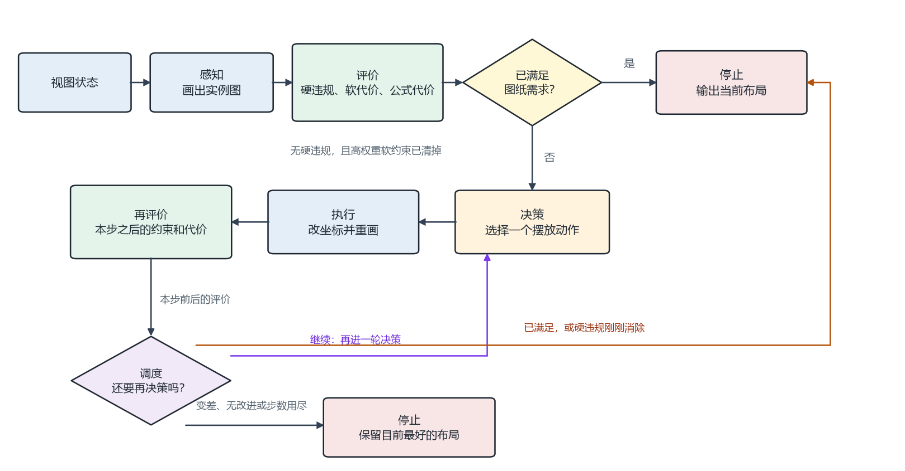

各模块的职责：

| 模块 | 职责 | 是否被学习替换 |
|---|---|---|
| 感知 | 由标注几何生成实例图，供模型看图 | 否 |
| 评价 | 统计硬违规、软代价和公式代价。结果决定能否停止 | 否 |
| 决策 | 已满足则接受并停止；否则在合法摆放动作里选一步 | 是，仅这一层 |
| 执行 | 把动作落到标注坐标上，并重画实例图 | 否 |
| 调度 | 比较一步前后的评价，决定再进入决策，还是停止。不改标注 | 否 |

决策替换之后，执行器仍然拒绝不合法的改动。评价用的合法图框在每张图开始时冻结，用来判断出框。渲染用的图框可以扩大，只为了把挪出去的文字画进图里，不参与约束判断。

奖励分成两层：

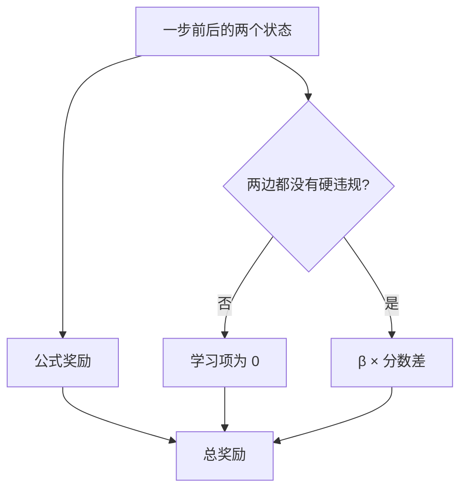

公式奖励看硬违规减少了多少、软代价下降了多少，并加上消除硬违规的奖励、每步的小惩罚、无效动作的惩罚。学习项是 β 乘以后一状态分数减去当前状态分数。任一边仍有硬违规时，学习项为 0，避免用观感分数去抵消硬冲突。β 默认是 0，总奖励就只剩公式项。

## 3. 已训练的模型：残差评分器

残差评分器给一张布局打一个越高越好的排序分，供学习项使用。显示分裁到 0–100。

### 3.1 结构

排序分等于公式分加网络输出的残差项。公式分不进入网络，直接跳到最后相加。图像走 ResNet18，16 维公式特征走两层全连接，两路拼成 544 维后再压成一个残差项。张量尺寸按通道 × 高 × 宽书写。

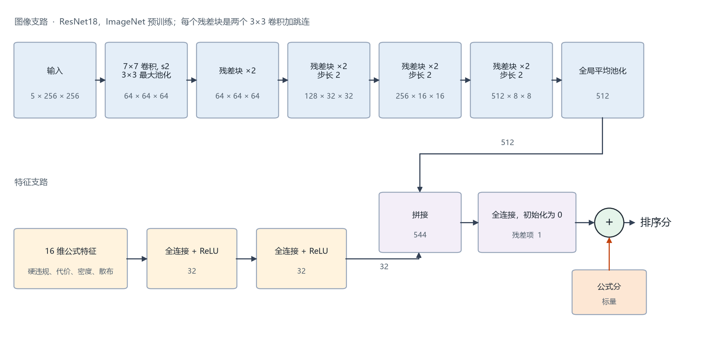

图像五通道是：实例图的红、绿、蓝，零件轮廓掩码，文字框掩码。没有现成实例图时，按标注几何现画。

红、绿、蓝是显示器和图像文件的三个通道，ImageNet 预训练权重也按这三个通道训练。红、黄、蓝是颜料混合用的三原色，数字图像里没有黄通道。实例图按屏幕图像存储，所以前三通道是红、绿、蓝。后两通道另加零件轮廓和文字框，第一层卷积从 3 通道扩成 5 通道，多出来的两个通道用原来三通道权重的平均值初始化。

骨干用 ResNet18。它在每个阶段用跳连把输入加回卷积结果，深层梯度可以直接回到浅层，578 对这种规模的数据也能训稳。ImageNet 预训练提供边缘和纹理的起点，不必从随机权重学起。18 层、约 1100 万参数，四张 A800 上全局批量 32 可以跑满，也小到能在评分时单张前向。

最后一层不是分类头。分类头会输出若干类别的概率。这里是一个线性层，把 544 维压成 1 个数，也就是残差项。权重初始化为 0，训练开始时残差项为 0，排序分等于公式分。网络只在人的偏好和公式不一致的地方改这个数。

输出是整张视图的一个分数，不是某一条尺寸的分数。排序分等于公式分加残差项，越高表示这张布局越好。残差项没有限制在 0 到 100，排序分可以是负数，也可以略高于 100。给人看的显示分再裁到 0–100。比较高低时用未裁切的排序分，否则大量负分会变成同一个 0。

公式分把规则统计折成 0–100，单项都是「代价越大，分数越低」：

$$
s(x, c) = \frac{100}{1 + x / c}
$$

$$
\begin{aligned}
S = &\ 0.50\, s(V_{\mathrm{hard}}, 1) + 0.18\, s(S_{\mathrm{layer}}, 2) + 0.12\, s(L_{\mathrm{path}}, 80) \\
&+ 0.10\, s(C_{\mathrm{crowd}}, 2) + 0.10\, s(S_{\mathrm{balance}}, 2)
\end{aligned}
$$

$V_{\mathrm{hard}}$ 是硬违规条数，$S_{\mathrm{layer}}$ 是分层代价，$L_{\mathrm{path}}$ 是直径和半径引线长度，$C_{\mathrm{crowd}}$ 是拥挤，$S_{\mathrm{balance}}$ 是四边不均。括号里的 1、2、80、2、2 是各项的尺度，用来把不同单位拉到相近的数值范围。若规则判定存在硬失败，公式分再压到不超过硬违规那一项：$S \leftarrow \min(S,\ s(V_{\mathrm{hard}}, 1))$。这里的硬失败包含尺寸线相交和文字蹭尺寸界线；审核五档里的硬约束不含这两项。

16 维特征来自同一套规则统计，包括公式分、总代价、硬违规条数的对数、是否硬失败、分层、引线长度、拥挤、四边密度和文字散布。网络在这些数上做修正，不从像素里重新学约束。

### 3.2 训练设置

| 项 | 取值 |
|---|---|
| 数据 | 578 对人工偏好，全部偏好改好的一侧 |
| 损失 | Bradley-Terry：让偏好侧的分数高于另一侧 |
| 残差正则 | 残差项平方的系数 0.02，避免偏离公式太远 |
| 优化 | AdamW，基础学习率 3e-4，按 4 卡放大 |
| 批量 | 每卡 8，四卡全局 32 |
| 轮数 | 最多 60，12 轮验证无提升则停 |
| 精度 | bfloat16 |
| 设备 | 四张 A800，编号 0–3 |
| 选模 | 按成对准确率 |

Bradley-Terry 要求偏好侧的分数高于另一侧。训练不约束分数落在 0–100，显示时再裁切。

验证集和冻结评测集的视图不在这 578 对里。

### 3.3 分数怎么读

全量 1574 张上：

| 量 | 均值 | 中位数 | 范围 |
|---|---:|---:|---|
| 公式分 | 35.9 | 25.0 | 0.9–100 |
| 残差项 | −11.3 | −10.7 | −36.8–5.5 |
| 排序分 | 24.6 | 14.1 | −34.3–102.2 |
| 裁到 0–100 的显示分 | 26.7 | — | 0–100 |

386 张显示分被裁成 0，6 张被裁成 100。排序分和公式分的 Spearman 相关是 0.95，残差项平均把公式分往下拉大约 11 分。一张典型的负分：公式分 1.6，残差项 −35.9，排序分 −34.3。

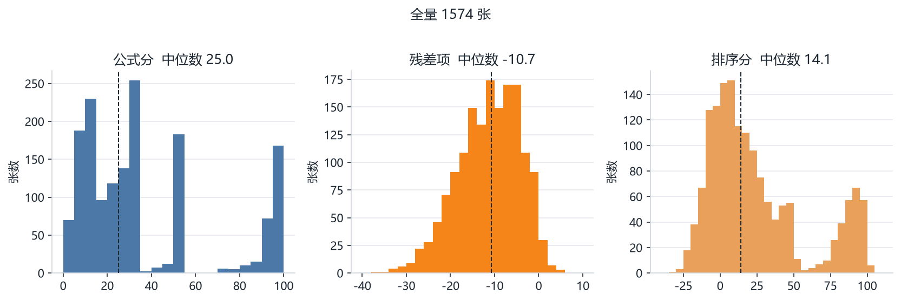

## 4. 策略网络

策略网络已经实现，只做了小规模通路验证，没有作为可上线模型训练。

它是带动作掩码的演员—评论员。图像经过三层卷积压成向量，和 21 维全局特征拼在一起形成上下文。每个候选动作有 36 维特征，用上下文做查询，得到该动作的分数。掩码把不合法动作的分数压到最低。评论员只看上下文，输出状态价值。

合法动作五类：接受、线性尺寸翻边、线性尺寸分层、线性尺寸两侧平衡、直径或半径改扇区。每步只执行一个动作。重复动作、几何上不改变图面的动作会事先去掉。

策略网络的图像是 3 通道。评分器的图像是 5 通道。

采集、行为克隆、掩码 PPO 已经串起来。行为克隆在留出视图上的公式代价高于贪心规则。PPO 做了十几步更新。

## 5. 算法

### 5.1 评分器

每一对训练样本有人偏好的布局和不偏好的布局。排序分 $s = S + r$，$S$ 是公式分，$r$ 是残差项。损失是

$$
\mathcal{L} = \frac{1}{N}\sum_{i=1}^{N} \operatorname{softplus}(s^{-}_{i} - s^{+}_{i}) + 0.02\left(\frac{1}{N}\sum_{i=1}^{N}(r^{+}_{i})^{2} + \frac{1}{N}\sum_{i=1}^{N}(r^{-}_{i})^{2}\right)
$$

$$
\operatorname{softplus}(z) = \ln(1 + e^{z})
$$

$s^{+}$、$r^{+}$ 是偏好侧的排序分和残差项，$s^{-}$、$r^{-}$ 是另一侧。$N$ 是一个批次里的对数。

第一项在偏好侧更高时接近 0，在不偏好侧反超时迅速变大。它只比较两个分数的高低，不要求分数落在 0–100。第二项把两侧残差项拉向 0，系数 0.02，避免网络为了拉开差距把公式分改得太远。验证时看严格准确率：偏好侧分数必须严格更高，同分算错。

### 5.2 策略

计划中的策略训练分三步，目前停在通路验证：

1. 用规则、贪心、集束搜索在仿真里采集轨迹。随机轨迹只留作对照，不进行为克隆。按视图切分训练和验证，再做扰动，避免同一张图的扰动同时出现在两边。
2. 行为克隆模仿专家动作。上线前要在留出视图上同时超过规则和贪心：硬违规消除率、最终公式代价、步数。这一关还没过。
3. 从行为克隆权重开始做掩码 PPO。奖励是第 2 节的公式项。学习项在第 5.3 节的条件满足后加上。

仿真接口遵循 Gymnasium：重置返回观测和信息，每步返回观测、奖励、结束、截断和信息。

### 5.3 学习项接入条件

学习项接入时核对四件事：checkpoint 与评测报告一致、人工标签处于冻结状态、T1 和 T2 的标签没有被换掉、成对准确率比公式至少高 0.02。

冻结集是 T1 136 张、T2 80 对。T2 上残差的严格准确率要达到 78.3%。同分算错。残差在这 80 对上是 86.3%，已经达到。

T1 继续使用 0–100 显示分，不再要求它和五档的 Spearman 比公式高 0.02。β 目前仍是 0，接入方式见第 9 节。

## 6. 数据

### 6.1 布局语料

唯一布局 1574 张，来自生产图纸的视图快照和人工配对。一张图可以同时属于多个来源，所以下表加总大于 1574。

| 来源 | 数量 |
|---|---:|
| 冻结 T1 | 136 张 |
| 其余已审核的 1–5 分 | 61 张 |
| 人工配对的训练侧视图 | 1110 张 |
| 人工配对的测试侧视图 | 332 张 |
| 有人工 1–5 分的视图 | 197 张 |
| 禁止进入后续训练的视图 | 468 张 |

排除在外的有：T1 废弃 173 张、未标注 1 张、合成扰动、以及两张公开零件图的扰动。

人工配对：训练 578 对，测试 170 对，偏好全部是改好的一侧。冻结 T2 是测试对中姿态差较大的 80 对，不是全部 170 对。

### 6.2 冻结评测

| 集 | 内容 | 来源 |
|---|---|---|
| T1 | 136 张。审核记录为 1–5 档，使用时看 0–100 显示分 | 已审核扰动训练视图 113，扰动留出 17，其他 6 |
| T2 | 80 对，左为缺陷、右为较好，人全部偏好右侧 | 人工配对测试集中姿态差较大的 80 对 |

选择种子是 17。

136 张的档次分布：1 档 5 张，2 档 12 张，3 档 37 张，4 档 44 张，5 档 38 张。1 档和 2 档样本很少。百分制显示分见第 7.1 节。

禁止训练的视图是三部分的并集：扰动留出、冻结 T1 和 T2 涉及的视图、人工配对的全部测试视图。评分实验可以给这些图打分，但不能拿它们的标签更新权重或挑选 checkpoint。

### 6.3 公开数据筛选

决定只使用带可动尺寸和轮廓的二维视图。筛完的结论：

| 数据 | 结论 |
|---|---|
| 公开零件增强图纸 | 只有两张种子图带尺寸，可映射成内部状态，只适合作为训练补充，尚未入库 |
| NIST 的 PMI 图纸包 | 是三维 PMI 和 PDF，不能直接进仿真 |
| ECCV 轮廓数据 | 抽查的图没有尺寸实体，不适用于本任务 |

两张种子图没有写入训练集，也没有写入冻结评测。

## 7. 实验

实验分四段：残差在冻结集上的百分制分数和成对准确率、残差在全量上的排序、外部模型的多种输入、人工档次和规则计数的对照。外部打分没有写入训练。

### 7.1 冻结集上的分数

残差在 136 张 T1 上继续使用的是 0–100 显示分。各档均分如下。后续不再为了让这些分数更贴近五档去改模型。

| 档次 | 张数 | 百分制含义 | 公式均分 | 残差显示均分 |
|---:|---:|---|---:|---:|
| 1 | 5 | 绝对混乱 | 9.1 | 6.7 |
| 2 | 12 | 有硬约束 | 7.2 | 4.1 |
| 3 | 37 | 硬约束很少，软约束较多 | 8.8 | 2.0 |
| 4 | 44 | 无硬约束，软约束较少 | 14.3 | 7.7 |
| 5 | 38 | 硬约束和软约束都没有 | 34.1 | 27.0 |

5 档的百分制明显高于 1–4 档。1–4 档的均分没有按档次递增。这组显示分保持现状。

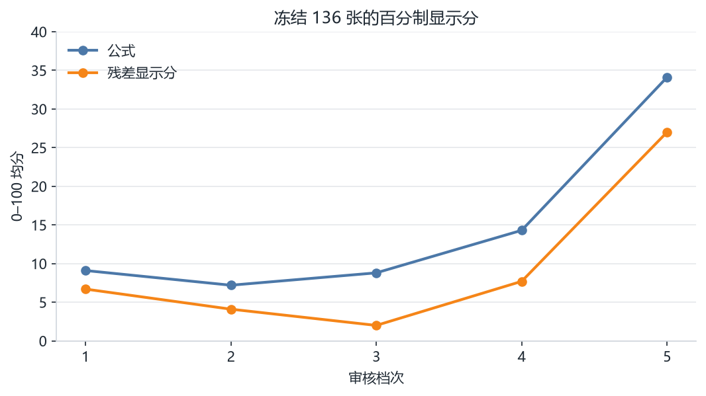

五档和百分制的顺序相关（Spearman）是：公式 0.511，残差 0.428。它只描述两种记法是否同向，不决定残差能否继续使用。

成对严格准确率里，同分算错。残差在冻结 80 对上是 86.3%（69 对对，11 对错），公式是 76.3%（61 对对，19 对错）。成对门槛是 78.3%，残差已经达到。

| 评分 | 训练 578 对 | 测试 170 对 | 冻结 80 对 |
|---|---:|---:|---:|
| 残差 | 91.9% | 77.6% | 86.3% |
| 公式 | — | — | 76.3% |

训练 578 对残差见过标签。测试 170 对是 77.6%，冻结的高姿态差 80 对是 86.3%。残差在训练对上的平均分差约 +22，在测试对上约 +11，没有同分。

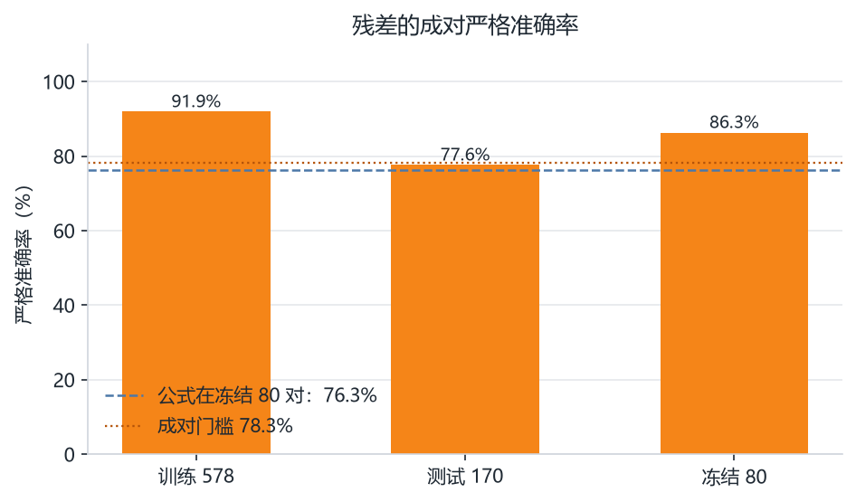

### 7.2 人工档次和规则计数

用规则评估器重算了 136 张。下表的「可见硬约束」只计文字重叠、穿尺寸线、碰引线、出框、进零件、压轮廓，不计尺寸线相交和文字蹭界线。

| 档次 | 可见硬约束中位数 | 可见硬约束为 0 的比例 | 规则硬失败比例 | 硬违规总条数中位数 | 软代价中位数 | 公式分中位数 |
|---:|---:|---:|---:|---:|---:|---:|
| 1 | 10 | 0% | 100% | 36 | 206 | 2.7 |
| 2 | 6 | 8% | 100% | 32 | 231 | 3.1 |
| 3 | 4 | 8% | 100% | 14 | 145 | 6.7 |
| 4 | 1 | 39% | 98% | 11 | 169 | 8.3 |
| 5 | 0 | 71% | 74% | 4.5 | 121 | 17.0 |

可见硬约束条数随档次下降，和标注标准同向。规则里的硬失败位几乎一直是真：4 档 98%、5 档 74% 仍被判为硬失败，多出来的主要是尺寸线相交和文字蹭界线。软代价没有把「软约束较多」和「软约束较少」分开，4 档的中位数软代价高于 3 档。

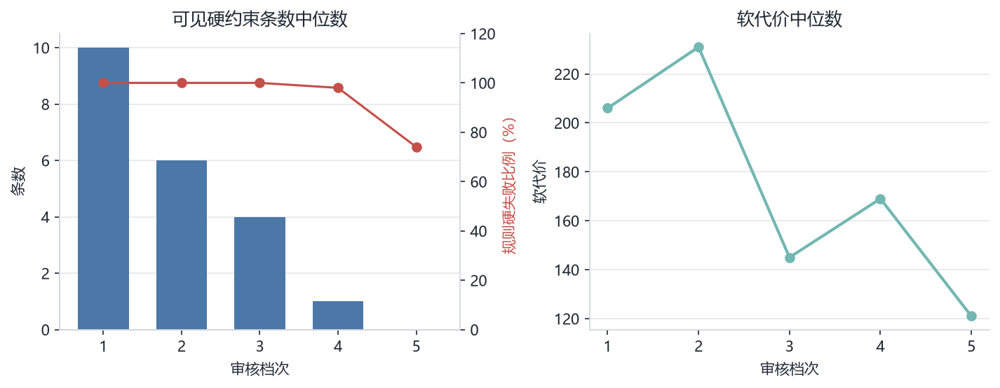

各违规类型的中位条数：

| 档次 | 文字重叠 | 穿尺寸线 | 尺寸线相交 | 蹭界线 | 碰引线 | 进零件 | 压轮廓 |
|---:|---:|---:|---:|---:|---:|---:|---:|
| 1 | 2 | 2 | 7 | 8 | 4 | 0 | 0 |
| 2 | 1 | 1 | 6 | 18 | 1 | 1 | 0.5 |
| 3 | 0 | 0 | 5 | 6 | 0 | 1 | 0 |
| 4 | 0 | 0 | 5 | 4 | 0 | 0 | 0 |
| 5 | 0 | 0 | 2 | 1 | 0 | 0 | 0 |

出框的中位数在各档都是 0。

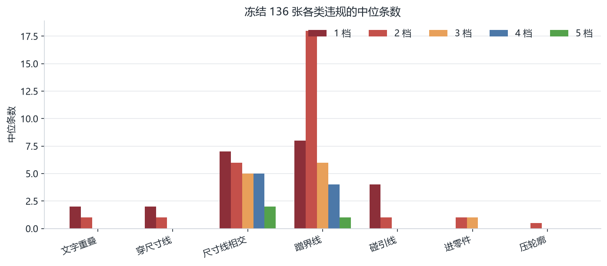

### 7.3 外部评分

同一批 1574 张交给两个外部模型打分，只作对照，没有回写训练。

DeepSeek 使用的是对话接口上的 deepseek-v4.1-flash。Jev 使用的是托管的 jev-1.13.0。托管 Jev 只接收文字，不接收图片。思考模式会占满输出长度，打分时关闭思考，要求直接给出 JSON。

文字摘要固定九行：视图类型，线性、直径、半径、粗糙度条数，文字框重叠数，文字与轮廓、文字与尺寸线的关系，文字中心是否在最大轮廓内、是否在视图框外，到被测边的中位偏移和超过 25 毫米的条数，四边数量。1574 张里有 1336 张文字框重叠为 0。摘要不把掩码重叠叫做文字冲突，也不把障碍线数量叫做压零件。

视图 JSON 过长时才压缩：先四舍五入坐标、抽稀折线，再去掉渲染冲突、栅格和颜色图例，最后按步长抽稀非闭环障碍。DeepSeek 的状态上限约 10 万字符，38 张被压过。Jev 更紧，文字加 JSON 有 58 张被压过。标注几何保留。

Jev 的 0–100 分由 10 档期望分线性映射：百分制分数 = 100 × 原始分 / 9。

| 搭配 | 输入 | 刻度 | 覆盖 |
|---|---|---|---|
| DeepSeek 文字 | 九行摘要 | 1–5 | 1574 |
| DeepSeek 只看截图 | 截图 | 0–100 | 1574 |
| DeepSeek 文字 + 截图 | 摘要和截图 | 0–100 | 1574 |
| DeepSeek 三输入 | 摘要、截图、JSON | 0–100 | 1574 |
| Jev 文字，早期 | 九行摘要 | 1–5 | 随机 100 |
| Jev 文字 | 九行摘要 | 0–100 | 1574 |
| Jev 文字 + JSON | 摘要和 JSON | 0–100 | 1574 |
| 残差模型 | 五通道图 + 16 维特征 | 公式分 + 残差 | 1574 |

还没有跑的搭配：DeepSeek 只用文字打成 0–100；DeepSeek 用文字加 JSON、不带截图。Jev 加图片做不到，托管接口不收图。

早期有一次文字摘要把掩码重叠和障碍线误写成冲突，模型几乎全打 1 分，该结果已作废。

#### 分数分布

| 搭配 | 均值 | 中位数 | 范围 | 与人工 197 条的 Spearman |
|---|---:|---:|---|---:|
| DeepSeek 五分文字 | 3.50 | — | 1–5 | 0.32 |
| DeepSeek 只看截图 | 73.3 | 78 | 20–95 | 0.17 |
| DeepSeek 文字 + 截图 | 68.4 | 75 | 20–95 | 0.25 |
| DeepSeek 三输入 | 79.2 | 78 | 0–95 | 0.44 |
| Jev 文字 | 77.7 | 82.9 | 20.6–97.4 | 0.58 |
| Jev 文字 + JSON | 68.8 | 72.9 | 17.6–95.3 | 0.21 |
| 残差排序分 | 24.6 | 14.1 | −34.3–102.2 | 0.24 |

五分 DeepSeek 的分布是 1 分 7 张、2 分 73、3 分 725、4 分 662、5 分 107。

只看截图时，完美侧和缺陷侧的中位数都是 78，人工 1–5 档的中位数也都是 78，分数堆在 75 和 78。文字加截图后，人工五档中位数变为 45、45、55、60、62，开始能分开，但相邻档很近。三输入和人工的相关最高，可是 3 到 5 档的中位数仍然都是 78。

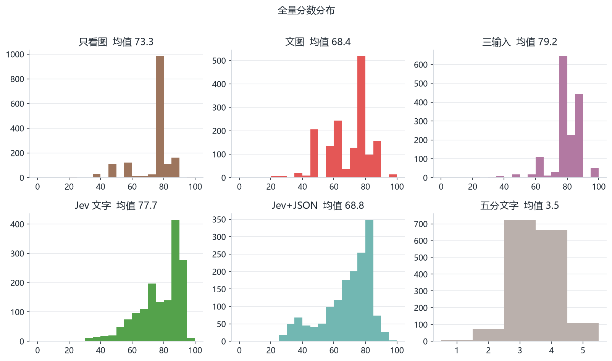

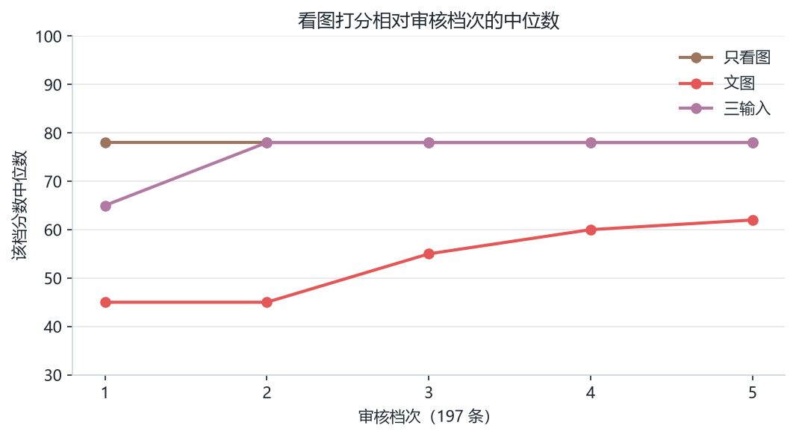

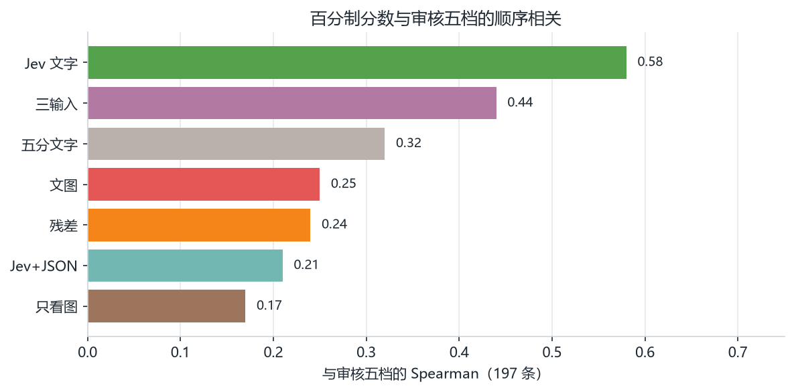

早期随机 100 条上，五分 DeepSeek 均分 3.45，五分 Jev 均分 4.39，等级相关 0.33，完全相同 33%，相差不超过 1 档 73%。Jev 更高的 67 条，相同 33 条，更低 0 条。这 100 条里有人工档的只有 12 张。

下表是百分制分数（或五分输出）与审核五档的顺序相关，以及 80 对上的严格准确率。残差在 T1 上继续使用的分数仍是第 7.1 节的 0–100 显示分。

| 评分 | T1 Spearman | T2 严格准确率 | 80 对里同分 |
|---|---:|---:|---:|
| 公式 | 0.511 | 76.3% | 0 |
| 残差 | 0.428 | 86.3% | 0 |
| Jev 文字 | 0.509 | 58.8% | 1 |
| Jev 文字 + JSON | 0.177 | 71.3% | 2 |
| DeepSeek 文字 + 截图 | 0.207 | 51.3% | 27 |
| DeepSeek 三输入 | 0.328 | 28.8% | 49 |
| DeepSeek 只看截图 | 0.243 | 36.3% | 37 |

早期只在随机 100 条里看 Jev 文字加 JSON，和 T1 的相关曾到 0.68，但那 100 条只盖住 10 张冻结 T1、0 对冻结 T2。全量数字以上表为准。

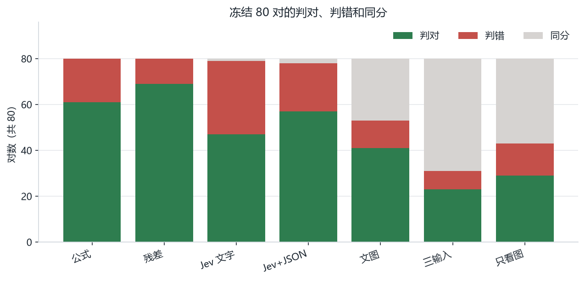

#### 成对严格准确率

同分算错。训练对上只有残差见过标签。

| 评分 | 训练 578 | 测试 170 | 冻结 80 |
|---|---:|---:|---:|
| 残差 | 91.9% | 77.6% | 86.3% |
| Jev 文字 + JSON | 85.1% | 70.6% | 71.3% |
| Jev 文字 | 80.3% | 60.6% | 58.8% |
| 公式 | — | — | 76.3% |
| DeepSeek 文字 + 截图 | 59.3% | 42.4% | 51.3% |
| DeepSeek 三输入 | 61.4% | 32.9% | 28.8% |
| DeepSeek 只看截图 | — | — | 36.3% |
| DeepSeek 五分文字 | 34.8% | 20.6% | — |

五分文字在训练对里有 333 对同分，测试对里有 117 对同分，所以严格准确率低。

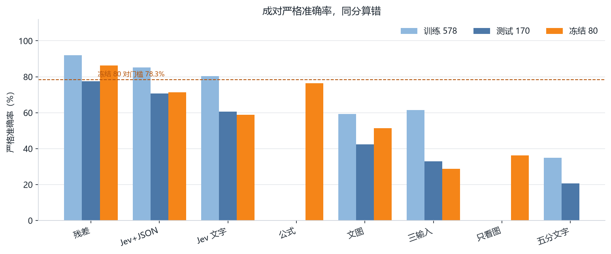

#### 模型之间的相关

Spearman，全量 1574：

|  | 残差 | Jev 文字 | Jev + JSON | 文图 | 三输入 |
|---|---:|---:|---:|---:|---:|
| 公式 | 0.95 | — | — | — | — |
| Jev 文字 | 0.49 | 1 | 0.74 | 0.48 | 0.65 |
| Jev + JSON | 0.54 | 0.74 | 1 | 0.67 | 0.74 |
| 文图 | 0.50 | 0.48 | 0.67 | 1 | 0.76 |
| 只看截图 | 0.37 | 0.37 | 0.34 | 0.39 | — |

三输入相对文图平均绝对差 11.2，1574 张里三输入更高的有 1235 张。文图相对只看截图平均绝对差 10.6。

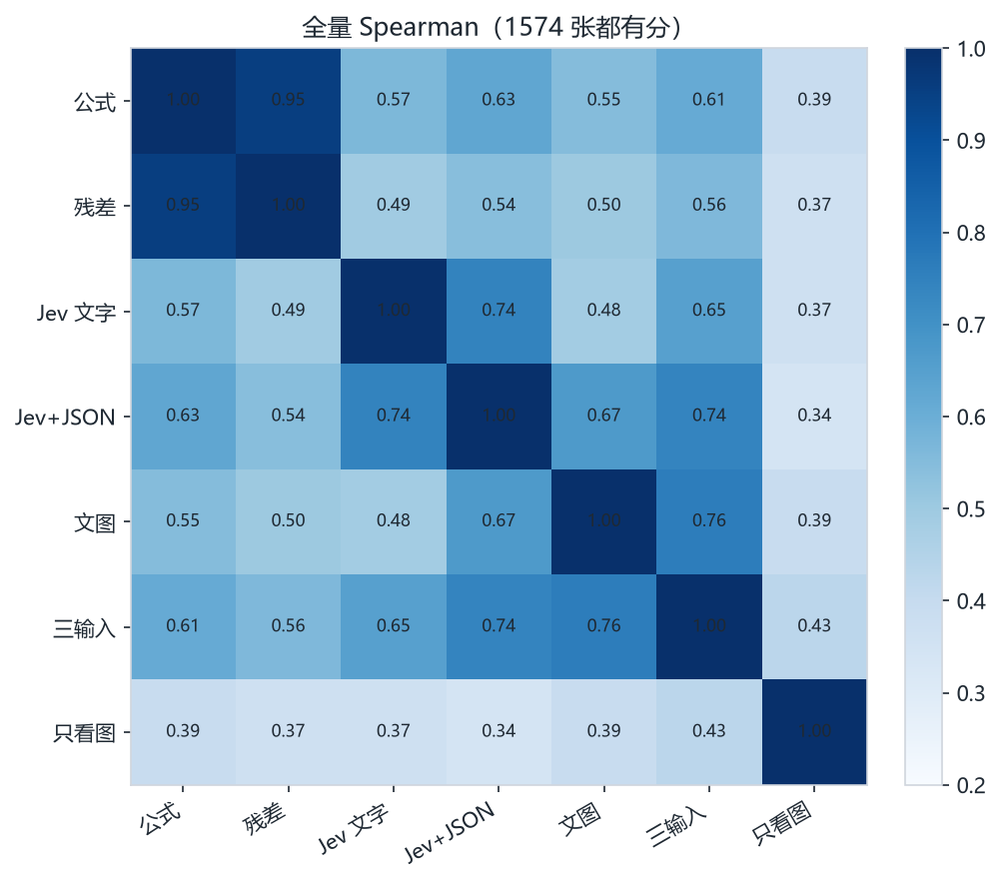

#### 百分制里的「完美」切分

用人工配对的两侧做约登指数，取整数切分。

| 搭配 | 切分 | 约登指数 | 精度 | 完美侧留下 | 缺陷侧留下 |
|---|---|---:|---:|---|---|
| 只看截图 | ≥ 75 | 0.16 | 55% | 663/748 | 542/748 |
| 文字 + 截图 | ≥ 78 | 0.20 | 60% | 448/748 | 298/748 |
| 三输入 | ≥ 82 | 0.27 | 64% | 467/748 | 265/748 |

只看截图时两侧中位数都是 78，切分几乎没有区分度。文字加截图和三输入能把两侧中位数分开几分，缺陷侧仍有三分之一以上越过切分。

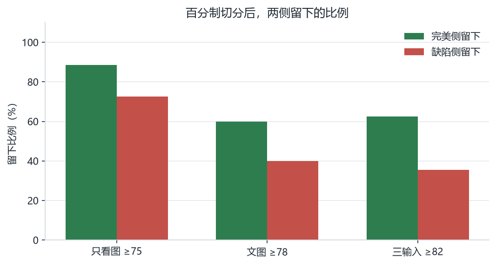

## 8. 分析与结论

### 8.1 残差模型

残差沿用公式的百分制，并在「明显较差」和「明显较好」之间拉大差距。冻结 80 对从 76.3% 升到 86.3%，测试 170 对是 77.6%。578 对训练标签都是大姿态差，损失只要求改好的一侧更高，所以 5 档的百分制被拉开。

T1 上继续使用第 7.1 节的 0–100 显示分。5 档均分 27.0，1–4 档在 2.0 到 7.7 之间。这组分数保持现状，不再为五档顺序做训练。

### 8.2 学习项怎么用这套分数

残差在冻结 80 对上比公式高约 10 个百分点，成对门槛已经达到。学习项使用的就是这个百分制分数的前后差。

学习项只在两边都没有硬违规时加上去。规则里的硬失败把尺寸线相交和文字蹭界线也算进去，4 档和 5 档里大部分图会被挡住。接入学习项时，硬失败按审核标准改成可见冲突；尺寸线相交和文字蹭界线单独统计。

### 8.3 外部打分

DeepSeek 和 Jev 都在 1574 张上打过全量，没有写入训练。结论分三层。

第一，它们都不能替代残差做逐步奖励。逐步奖励要的是相邻两步的分差。DeepSeek 看图之后分数堆在少数整数上，冻结 80 对里文图有 27 对同分，三输入有 49 对，只看截图有 37 对，严格准确率分别是 51.3%、28.8%、36.3%。同分使这一步的学习项变成 0。Jev 同分只有 1–2 对，但只看文字时 80 对准确率 58.8%，加上 JSON 后 71.3%，都低于公式的 76.3% 和残差的 86.3%。

第二，审核五档本身有主观性，尤其 3 档和 4 档只差软约束多少，1 档、2 档样本又少。在这个前提下，DeepSeek 的看图分数有参考价值，参考的是观感，不是硬约束判决。文字加截图之后，197 条人工档的中位数从 45 升到 62，说明它能跟着「更乱还是更干净」移动。三输入和这 197 条的 Spearman 是 0.44，是 DeepSeek 几种输入里最高的。只看截图时五档中位数都是 78，这一套没有参考价值。因此 DeepSeek 可以留作图纸观感的对照，用来抽查软约束多不多；不能把它的整数分当作逐步奖励，也不能把它写成人工标准。

第三，Jev 调用快、成本低，适合放在一轮优化结束之后，做一次整图复查，不放进每一步。只看文字时，它和审核五档的 Spearman 在 197 条上是 0.58，在冻结 136 张上是 0.509，接近公式的 0.511。这个相关说明它能给出和档次同向的快评。成对判断仍交给本地残差。接口和用法见 [Jev 说明](https://mp.weixin.qq.com/s/ynHlQijihuEZ3cqkQtXvrA)。托管接口只收文字，状态里可以放摘要，也可以再放视图 JSON。JSON 会把成对准确率从 58.8% 抬到 71.3%，同时把和五档的相关从 0.509 降到 0.177。复查若要对齐审核档次，用文字摘要；若要更接近成对偏好，再附上 JSON。

### 8.4 当前状态

| 项 | 状态 |
|---|---|
| 规则评价、执行、调度 | 在用 |
| 公式奖励 | 在用，0–100 |
| 残差评分器 | 继续使用。T2 86.3%。T1 使用 0–100 显示分，不再优化与五档的吻合 |
| β | 0 |
| 策略 | 通路验证已完成。行为克隆尚未超过贪心规则 |
| 外部打分 | 全量对照已完成，未写入训练 |

## 9. 后续计划

- 仿真环境按生产出图来建。视图进入环境后，Agent 在合法动作里调整标注位置。评价、执行和调度沿用现有规则。合法图框在回合开始时固定，渲染图框用来把挪出的文字画出来。

- 强化学习用在决策。一回合处理一张视图，每步从翻边、分层、两侧平衡、改扇区和接受里选一个动作。奖励看公式项里的硬违规和软代价有没有下降。两边都没有可见硬违规时，再把残差的百分制分差乘上 $\beta$ 加进去。尺寸线相交和文字蹭界线单独统计。$\beta$ 从 0 起，按硬违规消除率和最终公式代价逐步打开。

- 策略先做行为克隆。用规则、贪心和集束搜索在仿真里采轨迹。留出视图上的硬违规消除率、最终公式代价和步数超过规则和贪心之后，从克隆权重开始做带掩码的 PPO。

- 一轮优化结束后，用 Jev 对最终布局做一次复查。DeepSeek 的看图分数用来抽查观感。

- 其它部门会把现有布局算法拆成工具，交给布局 Agent 调用。Agent 决定调用哪一个工具、改哪一条标注，工具完成改坐标和重新评价。
