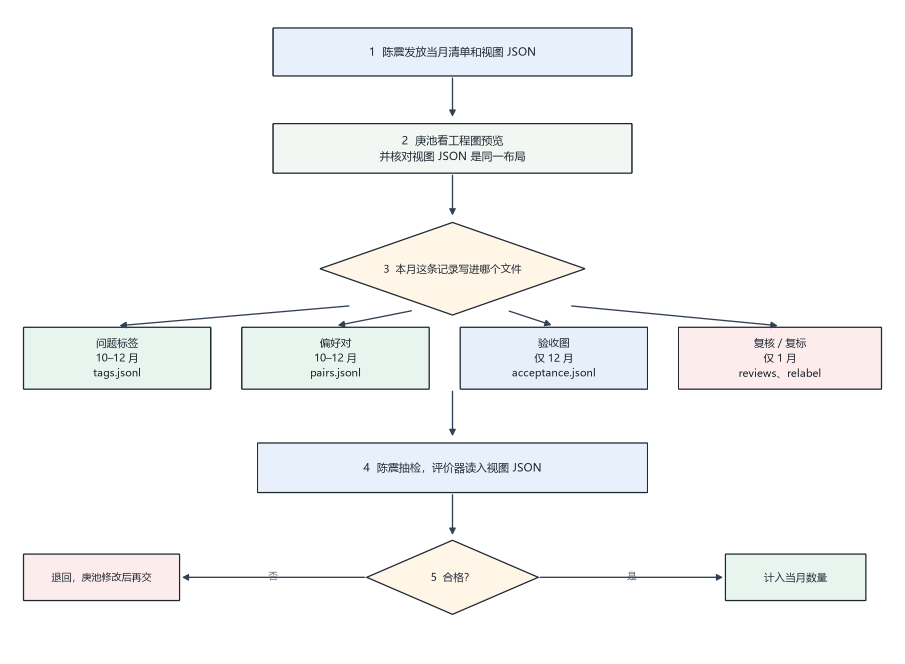
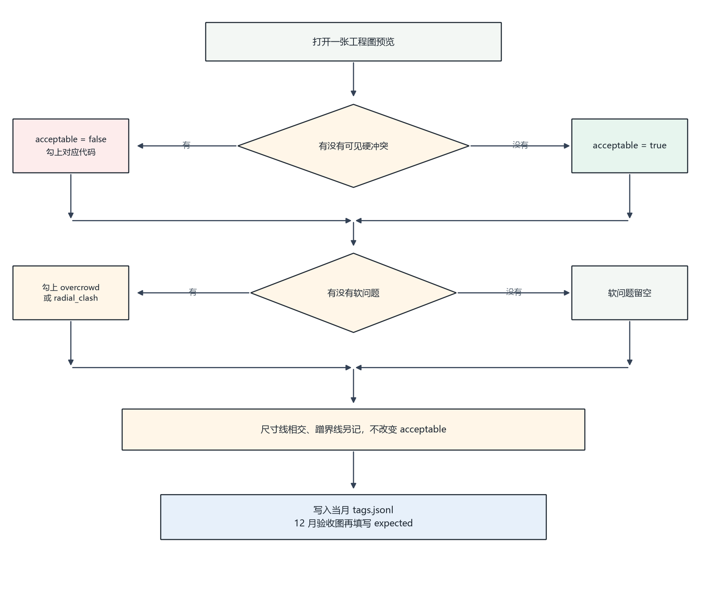

# 标注流程

日期：2026-10-10

标注人：庚池。清单、抽检和评价器读入：陈震。各月写哪些文件、每条有哪些字段，见 [标注规范](标注规范.md)。

看工程图预览，不看 ICM。不改几何，不标拖动过程，不标这一步该点哪个动作。

## 1. 总流程

1. 陈震按月发放清单和视图 JSON。清单写明这条是问题标签、偏好对、验收图，还是 1 月的复核、复标。已冻结的评测图不出现在清单里。
2. 庚池打开清单上的工程图预览，核对它和视图 JSON 是同一布局。对不上就退回，不猜测。
3. 按清单上的类型写入当月文件。10 月到 12 月写问题标签和偏好对。验收图只在 12 月写。复核和复标只在 1 月写。
4. 陈震抽检，并用评价器读入视图 JSON。
5. 合格的计入当月张数。不合格的退回，庚池改完再交。退回的条目在改完之前不计数。

每天结束前交当天新增，便于第二天抽检。

## 2. 一张图怎么标

问题标签和 12 月验收图都按下面的顺序看。验收图在写完标签后，再把希望消掉的代码填进 `expected`。

可见硬冲突是：文字重叠、穿尺寸线、碰引线、出框、进零件、压轮廓。有任意一项，`acceptable` 为 false，并勾上对应代码。

软问题是：单侧过密、直径半径打架。有就勾上，没有就留空。软问题可以和 `acceptable = true` 同时存在。

尺寸线相交、文字蹭界线看到了就另记。这两项不改变 `acceptable`，也不写入验收图的 `expected`。

## 3. 一对图怎么标

偏好对的左右两侧必须是同一个 `view_key`，也就是同一张生产视图的两种布局。

1. 左右各走一遍第 2 节，先看可见硬冲突，再看软问题。
2. 硬冲突更少的一侧为更好。硬冲突差不多时，软问题更少的一侧为更好。
3. 看不出差别的，不写 `prefer`，整对退回清单。
4. 写入当月 `pairs.jsonl`。`label.prefer` 只能是 `a` 或 `b`。

## 4. 各月走到哪一步

| 月份 | 庚池填写 | 写入文件 |
|---|---|---|
| 2026-10 | 800 张问题标签，100 对偏好 | `2026-10/tags.jsonl`，`2026-10/pairs.jsonl` |
| 2026-11 | 600 张问题标签，200 对偏好。优先标硬冲突明显的图 | `2026-11/tags.jsonl`，`2026-11/pairs.jsonl` |
| 2026-12 | 500 张问题标签，150 对偏好，200 张验收 | 同上两个文件，另加 `2026-12/acceptance.jsonl` |
| 2027-01 | 200 张验收结果复核，约 800 张复标 | `2027-01/reviews.jsonl`，`2027-01/relabel.jsonl` |

12 月验收图不进入轨迹采集。1 月的复核和复标不作为新训练集。1 月复核要等陈震把 Agent 输出的 `after_state` 放进目录后再看前后两张图。
